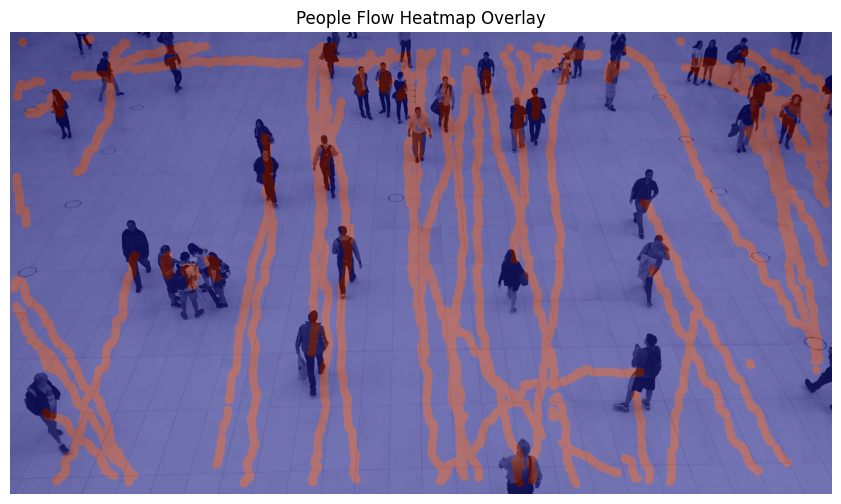

# 🚶 People Detection, Tracking & IN/OUT Counting System

A Computer Vision project that detects and tracks people in video footage, counts people entering and leaving a monitored area, and visualizes movement patterns using a heatmap.

The project uses **YOLOv8, ByteTrack, and OpenCV** to perform person detection, object tracking, movement analysis, and IN/OUT counting.

## 📌 Project Overview

This project implements a people movement monitoring system using deep learning-based object detection and object tracking techniques.

YOLOv8 is used to detect people in video frames, while ByteTrack maintains their identities by assigning unique tracking IDs across consecutive frames.

The system uses two horizontal counting lines to monitor people's movement:

- **IN:** Counts people moving from above the upper line to below it (top-to-bottom crossing).
- **OUT:** Counts people moving from below the lower line to above it (bottom-to-top crossing).

Additionally, a movement heatmap is generated to visualize the spatial distribution of detected people's positions throughout the video.

## ✨ Key Features

### 1. Person Detection
- Uses YOLOv8n for person detection.
- Detects only the person class.
- Processes video frames individually.

### 2. Object Tracking
- Uses ByteTrack for multi-object tracking.
- Assigns unique tracking IDs to detected individuals.
- Maintains previous positions of tracked people across frames.

### 3. IN/OUT Counting
- Uses two horizontal counting lines: upper and lower.
- Counts people crossing the upper line from top to bottom as IN.
- Counts people crossing the lower line from bottom to top as OUT.
- Uses tracking IDs to avoid counting the same tracked person repeatedly in the same direction.

### 4. People Movement Heatmap
- Records the center positions of detected people.
- Accumulates movement positions across video frames.
- Applies normalization and a JET color map.
- Generates a heatmap and a heatmap overlay on the original video frame.

### 5. Video Visualization
- Displays bounding boxes around detected people.
- Shows unique tracking IDs.
- Displays center points of detected individuals.
- Shows live IN and OUT counters on the processed video.

## 🛠️ Technologies & Libraries

| Technology | Purpose |
|---|---|
| Python | Programming language |
| YOLOv8 | Person detection |
| Ultralytics | YOLO model implementation |
| ByteTrack | Multi-object tracking |
| OpenCV | Video processing and visualization |
| NumPy | Numerical operations and heatmap generation |
| Supervision | Computer vision toolkit |
| Matplotlib | Heatmap visualization |
| Google Colab | Development environment |

## ⚙️ Project Workflow

1. **Video Input:** Download the input video from Roboflow.
2. **Video Information Extraction:** Retrieve FPS, width, height, and total frame count.
3. **Counting Line Initialization:** Define upper and lower horizontal counting lines based on video dimensions.
4. **YOLOv8 Detection:** Detect people in each video frame.
5. **ByteTrack Tracking:** Track detected individuals and assign unique IDs.
6. **Position Tracking:** Calculate and store the center coordinates of each detected person's bounding box.
7. **IN/OUT Counting:** Detect directional crossings of the counting lines and update the respective counters.
8. **Heatmap Generation:** Accumulate detected center positions and generate a movement heatmap.
9. **Output Generation:** Save the processed video, heatmap, and heatmap overlay.

## 📊 IN/OUT Counting Logic

The system uses two horizontal lines positioned according to the video height:

- Upper line: 35% of video height.
- Lower line: 65% of video height.

**IN Counting:**
When a tracked person's center moves from above the upper line to at or below it, the IN counter increases.

**OUT Counting:**
When a tracked person's center moves from below the lower line to at or above it, the OUT counter increases.

Each tracking ID is stored in separate sets for IN and OUT counting to prevent repeated counting in the same category.

## 🔥 People Movement Heatmap

The heatmap visualizes the spatial distribution of detected people's center positions throughout the video.

The process includes:

1. Recording the center coordinates of detected people.
2. Accumulating positions in a heatmap matrix.
3. Normalizing the accumulated values.
4. Applying the JET color map.
5. Overlaying the heatmap on the first frame of the original video.

Two heatmap outputs are generated:

- `final_heatmap.png` – Colorized movement heatmap.
- `heatmap_overlay.png` – Heatmap overlaid on the original video frame.

## 🎥 Project Outputs

The project generates the following outputs:

 Output File                           Description 

 `people_flow_output.mp4`               Processed video with detection, tracking IDs, and IN/OUT counters 
 `final_heatmap.png`                    People movement heatmap 
 `heatmap_overlay.png`                  Heatmap overlay on the original video 

### Processed Video

[▶ View People Detection & Tracking Output](people_flow_output.mp4)

### Heatmap Visualizations




## 📂 Repository Structure

```text
DL_movement_detection/
│
├── People_movement_detection.ipynb
├── people_flow_output.mp4
└── README.md
```

## 🚀 How to Run the Project

### 1. Clone the Repository

```bash
git clone https://github.com/Sabiba5557/DL_movement_detection.git
```

### 2. Install Dependencies

```python
!pip install ultralytics supervision opencv-python matplotlib
```

### 3. Load the YOLOv8 Model

```python
from ultralytics import YOLO

model = YOLO("yolov8n.pt")
```

### 4. Download the Input Video

```python
video_url = "https://media.roboflow.com/supervision/video-examples/people-walking.mp4"

!wget -q -O people-walking.mp4 $video_url
```

### 5. Run the Notebook

Open `People_movement_detection.ipynb` in Google Colab and execute the cells sequentially.

The notebook will process the video, perform detection and tracking, calculate IN/OUT counts, and generate heatmap visualizations.

## 📚 Concepts Explored

- Computer Vision
- Deep Learning-Based Object Detection
- YOLOv8
- Multi-Object Tracking
- ByteTrack
- Object Position Tracking
- Line-Crossing-Based People Counting
- Video Frame Processing
- Heatmap Generation
- Movement Visualization

## 👩‍💻 Author

Sabiba Karim
GitHub: [@Sabiba5557](https://github.com/Sabiba5557)

---

⭐ If you find this project interesting, feel free to explore the repository!
